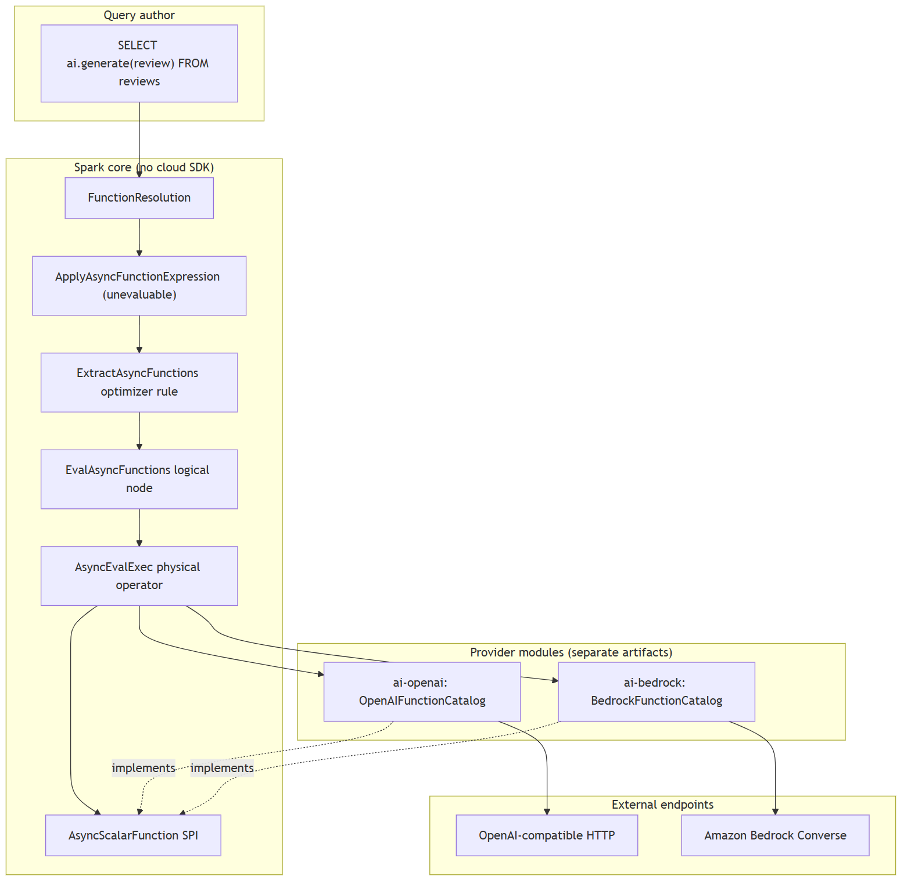
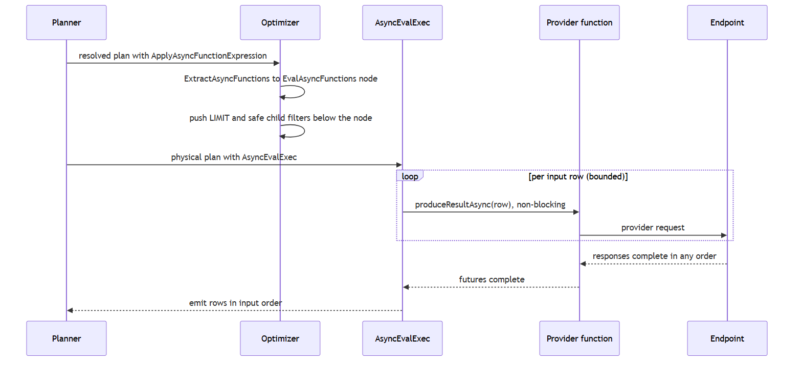
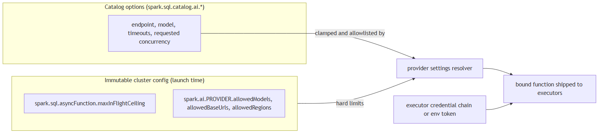

# SPARK-61672 architecture

This document describes the architecture of the native asynchronous AI function engine and the
provider modules built on top of it. It is the design-of-record for the incremental implementation
of Holden Karau and Prashant Singh's SPARK-61672 proposal, with Vaquar Khan as a contributing
author.

The rendered visual is in [`proposal/diagrams/provider-neutral-ai-functions.svg`](proposal/diagrams/provider-neutral-ai-functions.svg).

## 1. Design goals

1. One native execution engine that every Spark language (SQL, Scala, Java, Spark Connect) shares,
   rather than a Python-only UDF.
2. No cloud or vendor SDK in Spark core. Provider code lives in separate, swappable modules.
3. Overlap high-latency calls inside a task without giving up input order.
4. Bounded concurrency, spill of buffered input, and propagated cancellation, leaving Spark's
   stage, retry, and speculation model unchanged.
5. Administrator-owned cost and destination controls that a session cannot widen.

## 2. Layering

The design has three layers with a strict dependency direction: provider modules depend on the
SPI, the SPI lives in Spark, and Spark core depends on neither a provider nor a cloud SDK.

Diagram source: [`diagrams/arch-01-layering.mmd`](diagrams/arch-01-layering.mmd).

### 2.1 Spark core files

| File | Role |
| --- | --- |
| `sql/catalyst/.../functions/AsyncScalarFunction.java` | The SPI: row in, `CompletableFuture` out. Serializable, explicit determinism. |
| `sql/catalyst/.../expressions/ApplyAsyncFunctionExpression.scala` | Unevaluable call expression; stable per-call id. |
| `sql/catalyst/.../plans/logical/asyncFunctionLogicalOperators.scala` | `EvalAsyncFunctions` one-to-one logical node. |
| `sql/catalyst/.../analysis/FunctionResolution.scala` | Recognizes an `AsyncScalarFunction`. |
| `sql/catalyst/.../trees/TreePatterns.scala` | Expression and plan tree patterns. |
| `sql/catalyst/.../optimizer/Optimizer.scala` | `LIMIT` and safe child-filter pushdown below the call. |
| `sql/core/.../execution/async/ExtractAsyncFunctions.scala` | Innermost-first and aggregate-aware extraction into the logical node. |
| `sql/core/.../execution/async/AsyncEvalExec.scala` | Bounded, ordered, cancellable physical operator. |
| `sql/core/.../execution/SparkOptimizer.scala` | Registers extraction as a non-excludable correctness rule. |
| `sql/core/.../execution/SparkStrategies.scala`, `SparkPlanner.scala` | Maps the logical node to the operator. |

### 2.2 Provider module files

| Module | File | Role |
| --- | --- | --- |
| ai-openai | `OpenAIFunctions.scala` | Catalog, settings resolver with allowlist clamp, the three function forms. |
| ai-openai | `OpenAIClient.scala` | JDK HTTP client, retry classification, token bucket, circuit breaker. |
| ai-bedrock | `BedrockFunctions.scala` | Catalog, settings resolver with allowlist clamp, the three function forms. |
| ai-bedrock | `BedrockClient.scala` | Typed AWS SDK v2 async client, cancellation, circuit breaker. |

## 3. Query lifecycle

Diagram source: [`diagrams/arch-02-lifecycle.mmd`](diagrams/arch-02-lifecycle.mmd).

Steps in words:

1. Resolve: the function catalog returns an `AsyncScalarFunction`.
2. Represent: Catalyst wraps the call in an unevaluable expression so ordinary expression codegen
   never makes a remote call.
3. Extract: an optimizer rule moves the call into the `EvalAsyncFunctions` logical node, innermost
   call first, and above any aggregate it depends on.
4. Reduce cost: a `LIMIT` and child-only filters move below the node, so filtered and limited rows
   are never sent to the provider, even though the model is nondeterministic.
5. Execute: `AsyncEvalExec` submits a bounded number of futures, buffers input in a spillable
   `HybridRowQueue`, reorders results back into input order, cancels source futures on task kill,
   and closes provider resources once per task.

## 4. Concurrency and ordering model

Two independent bounds make per-task latency about `ceil(N / maxInFlight)` call times while keeping
memory bounded:

- Active-call bound (`maxInFlightPerTask`, clamped by the static cluster ceiling): how many remote
  calls may be running at once.
- Reorder-window bound: how many submitted rows may wait for ordered output. This stops a single
  stalled first row from accumulating unbounded completed responses behind it.

In-flight accounting is by provider-object identity (an `IdentityHashMap`), with one global ceiling
and one per-provider-object ceiling, so several functions on one row, or a shared bound-function
instance, cannot collectively exceed a bound.

## 5. Error model

| Form | Behavior |
| --- | --- |
| `ai.generate(prompt)` | Strict. A terminal provider error fails the task. |
| `ai.try_generate(prompt)` | Tolerant. A documented row-level error returns SQL NULL. |
| `ai.generate_status(prompt)` | Observable. Returns a struct with status, result, safe error code, and request id. |

Authentication, permission, and invalid-configuration errors stay fatal. Only sanitized error
codes surface; a prompt, token, or raw provider body never appears in an error, log, or plan.

At-least-once: a task retry, stage retry, speculation, or executor loss re-runs the partition and
re-issues its calls. The engine does not and cannot promise exactly-once external invocation.

## 6. Configuration and trust boundary

Diagram source: [`diagrams/arch-03-config-boundary.mmd`](diagrams/arch-03-config-boundary.mmd).

- Cluster ceilings and allowlists come from the immutable `SparkEnv` configuration; a session,
  including a Spark Connect session, cannot widen them.
- The requested endpoint and model are rejected unless they are on the allowlist, and the
  per-task active-call count is clamped to the static ceiling.
- Credentials are never read on the driver or placed in configuration. OpenAI reads a token from an
  executor environment variable; Bedrock uses the AWS default credential chain on the executor.

## 7. Provider portability

Switching providers does not change the business SQL. The administrator changes the catalog class
and the allowlisted model or endpoint; Spark core, the optimizer, and the physical operator are
unchanged. The provider module owns request construction, authentication, retry classification, and
response parsing. This is capability portability, not a claim that every model API is identical.

### 7.1 Relationship to SPARK-61454 stage pipelining

[[SPIP] Break the Stage Barrier: Pipelined Spark SQL for Agentic Workloads](https://issues.apache.org/jira/browse/SPARK-61454) addresses a different layer. SPARK-61672 overlaps remote calls inside an `AsyncEvalExec` task and leaves Spark stage scheduling and shuffle materialization unchanged. SPARK-61454 pipelines records across eligible batch shuffle boundaries and changes plan selection, connected-stage admission, distributed transport, and lifecycle management; it does not define remote functions, provider credentials, per-row error forms, or request concurrency.

Neither SPIP depends on the other. A future planner could place `AsyncEvalExec` inside a connected pipelined region, but that composition is not implemented or validated here. Before enabling it, tests must jointly bound provider calls, resident readers, producer waves, and transport buffers; prove progress when a remote call stalls; propagate cancellation across both domains; and clean up provider futures plus shuffle routes under the same run and stage-attempt generation. This POC assumes ordinary materialized stage boundaries.

## 8. Validation summary

| Evidence | Result | Location |
| --- | --- | --- |
| Combined core SQL suites | 25 passed (6 end-to-end, 7 provider parity, 12 safety/optimizer) | `poc/final-core-test4.log` |
| Live Spark SQL to Bedrock Converse | 1 passed, two typed AWS SDK v2 calls, NULL preserved | `poc/final-bedrock-live2.log` |
| Provider module compile and package | both module poms exit 0; generated jars intentionally excluded from this clean package | `spark-implementation/mvn-package.log` |
| Provider module conformance | 71 passed, 0 failed; 7 cases live against real services (OpenAI-compatible module against Bedrock's OpenAI-compatible API, Bedrock module against Converse) | `spark-implementation/conformance.log` |
| Both modules through real Spark SQL in one process | 25 passed; both catalogs loaded from configuration alone, `AsyncEval` planned, real services called, request ids captured, pushdown below the async node, real summaries over the example reviews | `spark-implementation/live-spark-sql-proof.log` |
| Throughput on real Bedrock through real Spark SQL | in-flight 1: 8,200 ms; in-flight 8: 1,416 ms; 5.79x; 24 of 24 correct; ordered | `spark-implementation/live-throughput-benchmark.log` |
| Adversarial review loop on the modules | 3 rounds, 35 findings fixed and re-verified | `semantic-review/` |

## 9. Provider module internals

The two modules share one shape, described here once.

Settings resolution runs on the driver in the catalog's `initialize`. Catalog options are read,
then every value is checked against the cluster configuration: endpoint, model, and region must be
on an allowlist; every numeric limit is clamped to its cluster ceiling (the module default when the
administrator set none); the credential source and breaker policy come from cluster configuration
only. The resolved, immutable settings are shipped to executors inside the serializable bound
function. No secret is carried; for OpenAI only the NAME of the executor environment variable is.

On the executor, a client is created lazily per connection identity (base URL plus credential
source, or region for Bedrock) and shared for the executor lifetime. All per-call tuning is passed
with each call, so varying options never creates clients or threads.

Each call passes through, in order: the per-endpoint circuit breaker (admission stamped with a
generation), the pacer (cluster ceiling shared per endpoint, session rate layered per catalog, a
CAS reservation that does not burn a slot on rejection), then the provider request with a
per-attempt budget that bounds headers and body and aborts the exchange on expiry. Retries honor
`Retry-After` and stop at the attempt count or the absolute deadline, which includes pacing. The
result future propagates cancellation to whichever stage is active.

Outcomes are classified into stable codes by status or exception class, never by message text.
Only endpoint-health codes (timeout, 5xx, throttling) feed the breaker. Fatal codes (auth, config,
TLS, missing model) fail the task in every form; everything else follows the form the user chose.
The exception that reaches the engine carries a code and a fixed safe message, and no cause chain.

Open items: a run on a multi-node cluster rather than `local[2]`, a live Databricks endpoint run,
and the full Pandas/Arrow comparison.
