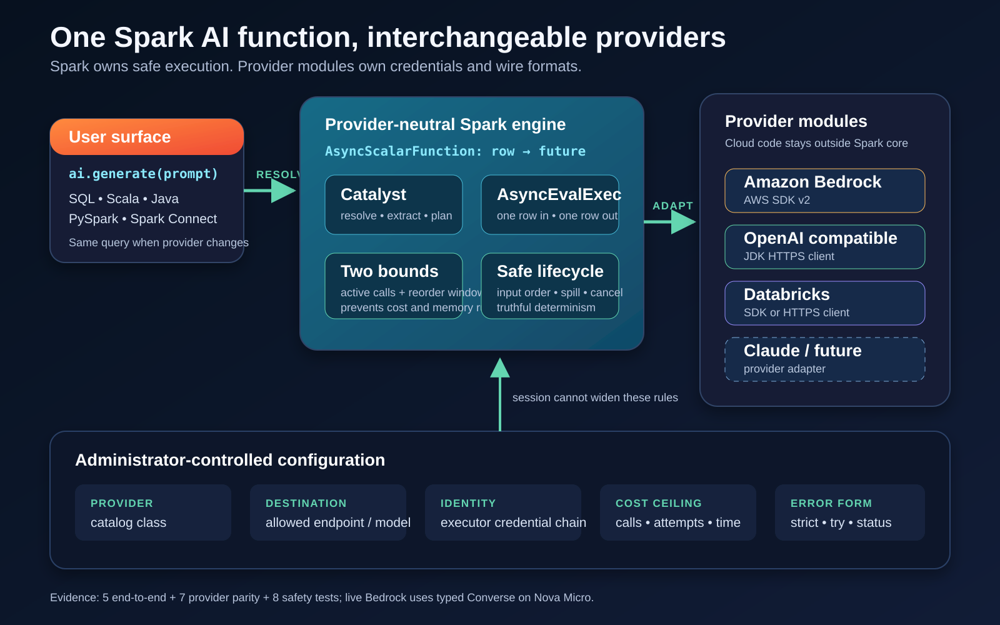

# Tutorial: AI functions in Apache Spark, explained simply

**Proposal lineage:** This tutorial explains an incremental implementation of Holden Karau and Prashant Singh's initial SPARK-61672 proposal, with Vaquar Khan joining as a contributing author. It is one team direction: Holden's native cross-language model, strengthened with tested execution, provider separation, safety bounds, and real Bedrock proof.



## TL;DR

Today, calling an AI model from Spark usually means writing a Python UDF, installing provider SDKs on every worker, and accepting that one failed model call can repeat a whole partition. We built a native Spark execution path where SQL calls a provider-neutral asynchronous function. Spark overlaps slow calls, keeps rows in order, limits how many calls are active, cancels source requests when a task stops, and keeps cloud-specific code outside Spark core.

The current prototype compiles and runs on Spark 4.3.0. Local suites cover end-to-end HTTP, Databricks and Bedrock response parity, and safety failures. A real Amazon Bedrock CLI smoke call also passed. The production provider modules and public benchmark remain future work.

## Five takeaways

1. A user writes normal SQL, such as `SELECT ai.generate(review) FROM reviews`.
2. Spark core knows only "row in, future out." It does not know AWS, OpenAI, Claude, Databricks, HTTP, or JSON.
3. A provider module handles authentication and the provider's request and response format.
4. A cluster administrator chooses the provider, model, endpoint, credential source, and safety ceilings. A query author cannot widen those choices.
5. The same SQL can move to another configured provider without rewriting the data pipeline.

## What problem are we solving?

Imagine a table with one million product reviews. You want an AI model to summarize every review.

A normal Spark calculation is local and fast. A model call is remote and slow. Some calls finish in 200 milliseconds. Others take several seconds. Some receive a rate-limit response or time out.

A simple UDF usually has four problems:

- It can process calls serially, which wastes most of the task's time waiting on the network.
- One failed call can fail the Spark task. Spark then repeats the whole partition, including successful paid calls.
- Python-only implementations do not give SQL, Java, Scala, and Spark Connect one shared engine.
- Every team invents its own credential, retry, error, and logging rules.

Vendor functions solve part of the usability problem, but each vendor uses different function names and behavior. That creates lock-in.

## How does this relate to "Break the Stage Barrier"?

Ferdinand Xu's draft [[SPIP] Break the Stage Barrier: Pipelined Spark SQL for Agentic Workloads](https://issues.apache.org/jira/browse/SPARK-61454) removes a different wait. This proposal overlaps remote model calls **inside one Spark task**. SPARK-61454 lets a downstream stage consume intermediate rows **before the upstream shuffle stage has fully materialized**.

They are independent and complementary. This proposal needs no scheduler or shuffle change, and it works with Spark's ordinary materialized stage boundaries. SPARK-61454 needs no AI function or provider module. If Spark later combines them, one query could overlap remote calls within tasks and producer/consumer work across selected stage boundaries. That combined path is future work because its two backpressure systems, cancellation paths, and cleanup lifecycles must be qualified together.

## What did the original SPIP propose?

Holden Karau and Prashant Singh proposed native AI functions, in-task asynchronous calls, per-call retries, tolerance for bad rows, UDF transpilation, and later streaming support.

We kept the central idea: native AI inference, asynchronous calls inside a task, and per-call retries.

We changed four mechanisms after checking Spark 4.3.0 and building the prototype:

- We preserve row order instead of requiring out-of-order output.
- We use strict, `try_`, and status function forms instead of `spark.task.maxFailurePercentage`.
- We removed automatic UDF transpilation because Spark cannot safely infer the meaning of a pickled Python function.
- We removed "failed rows stay behind without a dead-letter destination" because a held row needs durable storage.

## What did we build?

### The public contract

We added a small interface named `AsyncScalarFunction`.

In plain words, the interface says:

> Spark gives the provider one input row. The provider starts work without blocking and returns a future. Spark waits for futures in a controlled way and adds each result to the correct row.

The interface is serializable because Spark sends it to executors. Provider clients and credentials must be transient and created on the executor.

### The Spark execution path

When Spark sees this query:

```sql
SELECT review, ai.generate(review) AS summary
FROM reviews
WHERE stars = 5
LIMIT 100;
```

it performs these steps:

1. **Resolve.** The function catalog returns an `AsyncScalarFunction`.
2. **Represent.** Catalyst creates an unevaluable expression. This prevents normal expression code from accidentally making a remote call.
3. **Extract.** An optimizer rule moves the call into `EvalAsyncFunctions`, a dedicated logical plan node.
4. **Reduce cost.** A safe filter on ordinary columns and a local limit move below that node. Filtered and limited rows do not reach the provider.
5. **Plan.** Spark maps the logical node to `AsyncEvalExec`.
6. **Submit.** The operator starts a bounded number of provider futures.
7. **Buffer.** Input rows use Spark's spillable `HybridRowQueue` instead of unbounded heap.
8. **Reorder.** Calls may finish in any order, but results leave in input order.
9. **Cancel.** A killed task cancels the source future, not only a wrapper future.
10. **Close.** Spark closes the input queue and provider resources when the task finishes.

## Why are there two bounds?

Suppose Spark allows 16 active requests. Request 1 stalls, while requests 2 through 16 finish. If Spark uses only the active-request limit, it can start requests 17 through 31, then 32 through 46, and keep accumulating finished responses behind request 1.

The design uses two independent limits:

- **Active-call limit:** how many remote calls may be running.
- **Reorder-window limit:** how many submitted rows may be waiting for ordered output.

The second limit prevents a stalled first row from growing memory without a bound.

## What happens when a call fails?

There are three user-visible forms:

| Form | Behavior |
| --- | --- |
| `ai.generate(prompt)` | Strict. A terminal provider error fails the task. Spark's normal retry behavior applies. |
| `ai.try_generate(prompt)` | Tolerant. A documented row-level provider error returns SQL NULL. |
| `ai.generate_status(prompt)` | Observable. Returns a struct with result, status, safe error code, attempts, and request id. |

Authentication, permission, invalid configuration, and programming errors stay fatal. They must not be converted to NULL.

This design does not promise exactly-once model calls. Spark can repeat a task after failure, executor loss, stage retry, speculation, or another action. A repeated task can repeat paid calls.

## How will a user connect to Amazon Bedrock, OpenAI, or Claude?

These provider modules are built, packaged as jars, and tested (see `../spark-implementation/`). A 71-case conformance harness exercises them through the same catalog path Spark uses, and both modules were run live: the Bedrock module against Amazon Nova Micro over Converse, and the OpenAI-compatible module against Amazon Bedrock's OpenAI-compatible Chat Completions API with a bearer token. Both were then run through real Spark SQL in one process. The class names and configuration below are real.

One rule to understand before the examples: settings come in two kinds. Catalog settings (`spark.sql.catalog.ai.*`) are what a user or a session may set, and they can only make a limit tighter. Cluster settings (`spark.ai.<provider>.*` and `spark.sql.asyncFunction.maxInFlightCeiling`) are set once by the administrator at launch; they are the ceilings, the allowlists, the credential source, and the circuit-breaker policy, and no session can change them.

### Amazon Bedrock

The administrator installs the Bedrock provider module and sets static configuration:

```text
# catalog settings (a session may lower limits here, never raise them)
spark.sql.catalog.ai=org.apache.spark.sql.ai.bedrock.BedrockFunctionCatalog
spark.sql.catalog.ai.region=us-east-1
spark.sql.catalog.ai.modelId=amazon.nova-micro-v1:0

# cluster settings (administrator, at launch; a session cannot change these)
spark.ai.bedrock.allowedModels=amazon.nova-micro-v1:0,anthropic.claude-sonnet-4-5
spark.ai.bedrock.allowedRegions=us-east-1
spark.ai.bedrock.maxTokens=1024
spark.ai.bedrock.breakerFailureThreshold=10
spark.sql.asyncFunction.maxInFlightCeiling=16
```

The provider uses the AWS SDK default credential chain on each executor. That supports an EC2 role, container workload identity, Kubernetes identity, or an approved local profile. Access keys are not placed in SQL or Spark configuration.

Example:

```sql
SELECT id, ai.generate(prompt) AS answer
FROM prompts;
```

### Claude through Amazon Bedrock

Change only the administrator-selected model:

```text
spark.sql.catalog.ai.modelId=anthropic.claude-sonnet-4-5
```

The SQL stays the same:

```sql
SELECT id, ai.generate(prompt) AS answer
FROM prompts;
```

### OpenAI-compatible endpoint

Install the OpenAI-compatible provider module:

```text
# catalog settings
spark.sql.catalog.ai=org.apache.spark.sql.ai.openai.OpenAIFunctionCatalog
spark.sql.catalog.ai.baseUrl=https://approved.example.com/v1
spark.sql.catalog.ai.chatModel=approved-model

# cluster settings
spark.ai.openai.allowedBaseUrls=https://approved.example.com/v1
spark.ai.openai.allowedModels=approved-model
spark.ai.openai.credentialEnv=AI_PROVIDER_TOKEN
spark.ai.openai.maxResponseBytes=16777216
spark.ai.openai.ratePermitsPerSec=50
spark.sql.asyncFunction.maxInFlightCeiling=16
```

The executor reads `AI_PROVIDER_TOKEN` from its environment. The token does not enter the logical plan. The name of that variable is a cluster setting on purpose: if a session could choose it, a user could point the catalog at any secret the executor holds and have it sent as a bearer token. A catalog option named `credentialEnv` is rejected.

The SQL remains:

```sql
SELECT id, ai.generate(prompt) AS answer
FROM prompts;
```

### Direct Anthropic API

A future Anthropic provider module would implement the same `AsyncScalarFunction` interface and own Anthropic's typed client and response model. The query still calls `ai.generate`. The administrator changes the catalog class and allowed model. Spark core does not change.

## What changes when the provider changes?

| Item | Changes? |
| --- | --- |
| Business SQL | No, if the provider exposes the same capability alias such as `ai.generate`. |
| Spark optimizer and physical operator | No. |
| Provider module | Yes. It builds and parses that provider's request. |
| Administrator configuration | Yes. Catalog class, approved endpoint/model, and credential source. |
| Credentials | Yes, on executors through the provider's approved credential mechanism. |
| Test contract | Same shared contract plus provider-specific conformance tests. |

The goal is capability portability, not pretending every model API is identical. A provider module translates the stable function into its own wire format.

## What code changed?

| Area | File | Purpose |
| --- | --- | --- |
| Catalyst API | `AsyncScalarFunction.java` | Provider-neutral asynchronous function contract. |
| Catalyst expression | `ApplyAsyncFunctionExpression.scala` | Unevaluable call and truthful determinism identity. |
| Logical plan | `asyncFunctionLogicalOperators.scala` | One-to-one async evaluation node. |
| Function resolution | `FunctionResolution.scala` | Recognize the new function type. |
| Tree pruning | `TreePatterns.scala` | Expression and plan patterns in the correct sections. |
| Optimizer | `Optimizer.scala` | Push `LIMIT` and safe child filters below the call. |
| Extraction | `ExtractAsyncFunctions.scala` | Move innermost calls into async plan nodes. |
| Physical execution | `AsyncEvalExec.scala` | Bounds, order, spill, cancellation, cleanup, and metrics. |
| Optimizer registration | `SparkOptimizer.scala` | Run extraction as a non-excludable correctness rule. |
| Planning | `SparkStrategies.scala`, `SparkPlanner.scala` | Map the logical node to the physical operator. |
| Live provider proof | `BedrockLiveAsyncFunctionSuite.scala` | Typed AWS SDK v2 Converse call, opt-in and paid. |

## Tutorial exercise: run it with sample data

The production catalog names below are the intended public interface. The current tests use `testcat` and test provider classes because the production provider artifacts are not packaged yet.

### Sample input

| id | review | stars |
| ---: | --- | ---: |
| 101 | Battery lasted all day and setup was simple. | 5 |
| 102 | Package arrived late. | 2 |
| 103 | Clear instructions and fast performance. | 5 |
| 104 | NULL | 5 |

Create a view:

```sql
CREATE OR REPLACE TEMP VIEW reviews AS
SELECT * FROM VALUES
  (101, 'Battery lasted all day and setup was simple.', 5),
  (102, 'Package arrived late.', 2),
  (103, 'Clear instructions and fast performance.', 5),
  (104, CAST(NULL AS STRING), 5)
AS reviews(id, review, stars);
```

Run the function:

```sql
SELECT id, ai.generate(review) AS summary
FROM reviews
WHERE stars = 5
LIMIT 3;
```

Expected behavior:

| id | Provider call? | Expected result |
| ---: | --- | --- |
| 101 | Yes | A model-generated summary. |
| 103 | Yes | A model-generated summary. |
| 104 | No | NULL, because the input is NULL. |
| 102 | No | The filter moves below async evaluation, so this row is not billed. |

The exact summary text is provider-dependent. The row count, NULL behavior, call count, safety bounds, and row/result association are provider-independent.

### Real local test data and results

The end-to-end loopback test sends deterministic values so it can assert exact output:

| Input | Simulated provider output |
| --- | --- |
| `hello` | `HELLO` |
| `w0` through `w199` | Each matching uppercase value, in the same sequence. |
| NULL | NULL without a request. |
| `/boom` route | HTTP 500; strict query fails. |

The provider-parity suite uses both real response shapes:

| Emulated provider | Response field | Cases |
| --- | --- | --- |
| Databricks / OpenAI chat completions | `choices[0].message.content` | success, NULL, HTTP 400 strict/null, 429 then success, 120-row order |
| Amazon Bedrock Converse | `output.message.content[].text` | success and NULL |

The live Bedrock test uses this input:

| Input | Actual Nova Micro result |
| --- | --- |
| `Reply with exactly A` | `A` |
| `Reply with exactly B` | `B` |
| NULL | NULL without a Bedrock call |

Result: `Tests: succeeded 1, failed 0`, `BUILD SUCCESS` in `../poc/final-bedrock-live2.log`.

### Run the local Spark suites on Windows

Prerequisites used for this proof:

```powershell
$env:JAVA_HOME = 'C:\Program Files\Microsoft\jdk-17.0.17.10-hotspot'
$env:HADOOP_HOME = 'C:\spark-build\tools\hadoop'
$env:PATH = "$env:HADOOP_HOME\bin;$env:PATH"
```

Run every local async SQL suite:

```powershell
& 'C:\spark-build\tools\apache-maven-3.10.0\bin\mvn.cmd' `
  -pl sql/core -am test `
  '-DwildcardSuites=org.apache.spark.sql.execution.async' `
  '-Dtest=none'
```

Final expected line:

```text
Tests: succeeded 25, failed 0, canceled 0, ignored 0, pending 0
BUILD SUCCESS
```

### Run the opt-in live Bedrock proof

This is a paid integration test. Use a dedicated least-privilege identity with only `bedrock:InvokeModel` on the selected model. The local validation account had only administrator profiles, so the proof used one minimal model, two short prompts, one partition, one in-flight request, and one SDK attempt.

```powershell
$env:SPARK_TEST_LIVE_BEDROCK = '1'
$env:SPARK_TEST_BEDROCK_REGION = 'us-east-1'
$env:SPARK_TEST_BEDROCK_MODEL_ID = 'amazon.nova-micro-v1:0'
$env:AWS_PROFILE = '<approved-profile>'

& 'C:\spark-build\tools\apache-maven-3.10.0\bin\mvn.cmd' `
  -pl hadoop-cloud -am -Phadoop-cloud test `
  '-DwildcardSuites=org.apache.spark.sql.execution.async.BedrockLiveAsyncFunctionSuite' `
  '-Dtest=none'
```

Expected result:

```text
native async SQL calls live Bedrock Converse
Tests: succeeded 1, failed 0
BUILD SUCCESS
```

## Runnable examples folder

The `examples/` folder next to this tutorial holds dummy data, per-provider SQL, and a report you
can review or run:

- `examples/data/reviews.csv` and `reviews.jsonl`: ten dummy reviews, two with a NULL body.
- `examples/sql/01-bedrock.sql`, `02-openai.sql`, `03-claude-via-bedrock.sql`: the full launch
  configuration and SQL for each provider. The SQL is identical across all three; only the launch
  configuration changes.
- `examples/report/RESULTS.md` and `examples/report/live-bedrock-summaries.csv`: the results of a real
  run. Spark SQL loaded both provider jars from configuration, called real services, and summarized
  the example reviews with a real model: for example "Battery lasted all day and setup was simple."
  became "Long battery, easy setup." The two NULL reviews stayed NULL without a call, and the two
  low-star reviews were filtered below the async node and never billed.

The program that produced those results is `../spark-implementation/conformance/LiveSparkSqlProof.scala`;
`../spark-implementation/live-spark-sql-proof.ps1` runs it. It is a paid run of a few short calls.

## What bugs did the tests find?

The tests changed the design. They found:

- a plan pattern in the expression section;
- a 64 MiB managed-memory page that was not closed;
- cancellation aimed at a dependent future instead of the source request;
- a race between the interrupt listener and task-thread cleanup;
- a zero concurrency setting that could spin forever;
- several functions on one row exceeding the call ceiling;
- nested functions extracted in the wrong order;
- missing limit and filter pushdown;
- stochastic calls incorrectly deduplicated;
- provider throws and null futures leaving inconsistent counters;
- a cloud-module test crossing two classloaders.

Each substantiated defect was fixed or explicitly left as an open item in the comparison document.

## Test evidence

| Evidence | Result |
| --- | --- |
| Final combined Spark SQL suite | 25 passed, 0 failed, BUILD SUCCESS. This includes 6 end-to-end, 7 provider parity, and 12 safety/optimizer cases. See `../poc/final-core-test4.log`. |
| Hardened safety suite | 12 cases in the final combined run, including filter call count, aggregate placement, static ceiling, shared-provider identity limit, shared close, and source cancellation. |
| Real Bedrock CLI smoke, Nova Micro | Returned `OK`; 6 total tokens; 223 ms. |
| Live Spark SQL Bedrock | 1 passed, 0 failed, BUILD SUCCESS. Two typed AWS SDK v2 Converse calls to Nova Micro; NULL input stayed NULL. See `../poc/final-bedrock-live2.log`. |
| Provider module conformance | 71 passed, 0 failed, against the packaged jars: allowlists, cluster ceilings, gzip, streaming size caps, Retry-After, deadlines, cancellation observed at the server, circuit breaker, pacing, concurrency, sanitization across every error path and form, 4 live calls through the OpenAI-compatible module against a real OpenAI-compatible service, and 3 live Bedrock calls through the module's catalog. See `../spark-implementation/conformance.log`. |
| Both modules through real Spark SQL, one process | 25 passed. Spark loaded both provider jars from configuration alone, planned `AsyncEval`, called real services, returned the right answers with service request ids, kept NULL rows NULL, placed `WHERE` and `LIMIT` below the async node, and produced real six-word summaries of the example reviews. See `../spark-implementation/live-spark-sql-proof.log`. |
| Adversarial review of the modules | Three independent rounds found 17, 12, and 6 issues (35 total, 7 of them high severity, including one that could have sent an executor secret to an endpoint). All 35 were subsequently fixed and covered by passing tests; round 3 had no high findings and did have 3 medium and 3 low findings. See `../semantic-review/`. |
| Live throughput benchmark on real Bedrock | Same Spark SQL over 24 prompts in one task, in-flight 1 versus 8: 8,200 ms versus 1,416 ms, 5.79x faster, 24 of 24 answers correct, input order preserved in both runs. Log: `../spark-implementation/live-throughput-benchmark.log`. A full Pandas/Arrow comparison remains a vote gate. |

## Where files and evidence live

| Item | Location |
| --- | --- |
| Incremental SPIP | `01-SPIP-incremental-for-Holden.md` |
| Three-way comparison and complete change log | `02-three-proposal-comparison-and-evidence.md` |
| This tutorial | `03-layman-tutorial.md` |
| Runnable examples, dummy data, report | `examples/` |
| Production provider modules | `../spark-implementation/connector/ai-openai`, `../spark-implementation/connector/ai-bedrock` |
| Diagram | `diagrams/provider-neutral-ai-functions.svg` |
| Spark implementation | `../../sql/catalyst` and `../../sql/core` |
| Live Bedrock test | `../../hadoop-cloud/src/test/.../BedrockLiveAsyncFunctionSuite.scala` |
| Logs | `../poc/` |
| Extracted SPARK-61404 PR source | `../ai_query_ref/` |

## Suggested IDE prompts for a reviewer

- `Show me every place ApplyAsyncFunctionExpression can reach execution without extraction.`
- `Verify that cancelJobGroup cancels the source provider future.`
- `Show the optimized plan for SELECT ai.generate(x) FROM t LIMIT 3.`
- `Prove two nondeterministic identical calls are not deduplicated.`
- `Find any path that can put a prompt, response body, or credential in an exception.`
- `Compare AiQueryParitySuite with SPARK-61404 test_ai_query.py.`

## Future work

1. Run the packaged provider jars through `spark-sql` on a cluster. The conformance harness drives the exact catalog path, and the planner path is proven separately, but the two have not been joined in one process yet.
2. Run the OpenAI-compatible module against a live Databricks Model Serving endpoint once an approved credential is available.
3. Add early analysis errors for unsupported joins, windows, aggregates, and streaming until each is designed.
4. Add task-retry and repeated-action tests that count duplicate provider calls.
5. Publish a benchmark against `mapInArrow` plus `asyncio` and the SPARK-61404 iterator Pandas UDF.
6. Ask the SPARK-61672 and SPARK-61404 authors to agree on the user-facing names while sharing one backend.

## Conclusion

The value is not one more AI function name. The value is one safe execution contract that every provider can implement and every Spark language can call. Spark owns planning, bounded concurrency, order, spill, and cancellation. Provider modules own credentials and wire formats. Administrators own destinations and cost ceilings. Query authors keep one SQL expression.

That split gives us portability without putting cloud code in Spark core, performance without changing the scheduler, and a testable path from a local HTTP stub to real Bedrock and future OpenAI or Claude modules.
